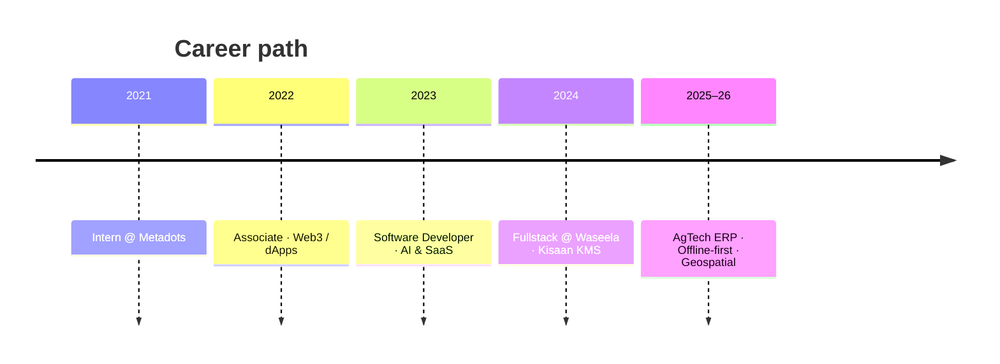

<!-- Profile README: github.com/SaadNiaziDev -->

# Hi, I'm Saad Ali Khan 👋

### Senior Full-Stack Engineer · Lahore, Pakistan

 

---

## At a glance

| 🗓️ Experience | 🚀 Products | 🌍 Focus | 📍 Based |
|:---:|:---:|:---:|:---:|
| **~5 years** | **30+ shipped** | **Full-stack · Web3 · AI** | **Lahore, PK** |

  

---

## What I ship

| 🌾 AgTech ERP | 🏥 Healthcare AI | 🛒 Marketplaces | ⛓️ Web3 |
|:---:|:---:|:---:|:---:|
| Waseela OS · Frappe 15 | FixtopAI · Lumed · Remedy+ | FixTop · MediaProQuo | Staking · NFT · dApps |
| Offline field UX | WebRTC · OpenAI · STT | Stripe · Socket.io | Wagmi · WalletConnect |
| Crop credit · HR · maps | LangChain · AssemblyAI | Gig & home services | Crypto payments |

---

## Journey

---

## Featured builds

| Product | Stack | Link |
|:---|:---|:---|
| **Waseela OS** | Vue 3 · Frappe · Offline · Leaflet | AgTech platform |
| **FixtopAI** | React · WebRTC · Node · AI | [fixtops.org](https://staging.fixtops.org/) |
| **Lumed** | React · OpenAI · LangChain | [lumed.ai](https://app.lumed.ai/) |
| **FixTop** | React · Express · Stripe · Socket.io | Home-services SaaS |
| **MediaProQuo** | React · TS · Redis · Stripe | Creator marketplace |
| **Kisaan KMS** | Docker · Microservices · Next | [kisaangroup.pk](https://kisaangroup.pk/) |

---

## Stack

### Frontend

### Backend & data

### Mobile · cloud · tools

  

---

## GitHub pulse

 

 

 

---

## Let's talk

**Open to remote / hybrid roles where ownership & shipping matter.**

 

 

