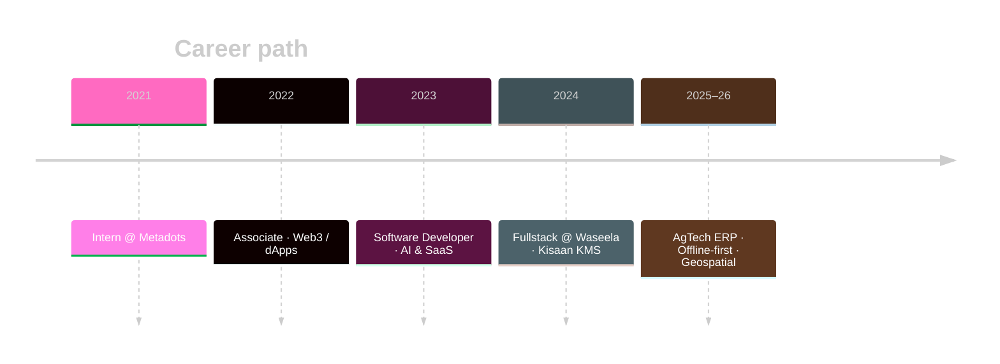

<!-- Profile README: github.com/SaadNiaziDev — neon / radical theme -->

 

---

 

  

---

 

| 🌾 AgTech ERP | 🏥 Healthcare AI | 🛒 Marketplaces | ⛓️ Web3 |
|:---:|:---:|:---:|:---:|
|  |  |  |  |
| Offline · Crop credit · Maps | WebRTC · OpenAI · STT | Stripe · Socket.io | Wagmi · WalletConnect |

---

---

 

| Product | Stack | Type |
|:---|:---|:---|
|  | Vue 3 · Frappe · Offline · Leaflet | AgTech platform |
|  | React · WebRTC · Node · AI | Virtual doctor |
|  | React · OpenAI · LangChain | Healthcare AI |
|  | React · Express · Stripe · Socket.io | Home-services SaaS |
|  | React · TS · Redis · Stripe | Creator marketplace |
|  | Docker · Microservices · Next | Agri management |

---

 

### Frontend

### Backend & data

### Mobile · cloud · tools

  

---

 

 

 

 

---

 

**Open to remote / hybrid · ownership & shipping first**

 

